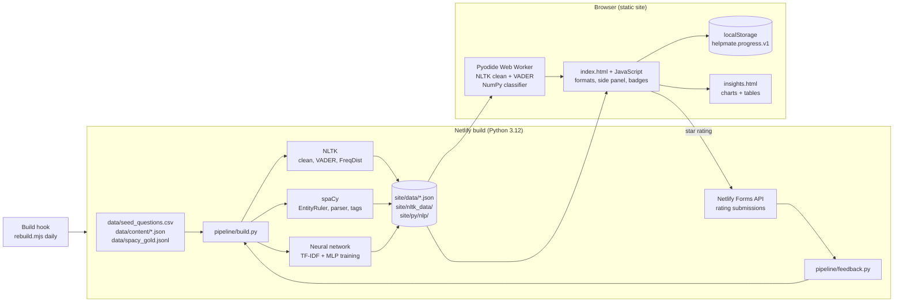

# HelpMate

HelpMate is a friendly self-help IT coach for people who are not technical. You type an IT question in your own words, for example "my printer wont print!!". HelpMate then:

- works out what kind of problem it is (Printer, Email, Wi-Fi & Internet, Passwords & Login, Slow computer, Phone & Apps, Files & Storage, Video calls) with a small **neural network**;
- notices if you sound frustrated and switches to a calmer tone (**NLTK** VADER);
- points out the device, app, system or error code you mentioned (**spaCy**);
- gives help in the format you choose: **See it** (numbered steps), **Hear it** (read aloud), **Try it** (a checklist you tick) or **Read it** (a printable page).

An optional 10-step mini-course per topic tracks your progress and awards a badge. Star ratings feed back into the app every time it is rebuilt. Every result on screen carries a small label that says which library made it: NLTK, spaCy, Neural network, or both.

The whole site is static and runs on Netlify. There is no backend server and no database.

## Version 1 status

Version 1 is live at https://helpmate2300nlp.netlify.app. 21 of 32 user stories are Met, 10 Partly met, 1 Not met; the live in-browser NLTK + neural-network path was checked in a real Chrome browser on 2026-11-23. Tests: 163 passed, 24 skipped (need NLTK/spaCy locally).

- [docs/version-1-report.md](docs/version-1-report.md): what was built, quality numbers, and what is left for version 2
- [docs/requirements.md](docs/requirements.md): user stories, acceptance criteria and v1 status (Nora)
- [docs/architecture.md](docs/architecture.md) and [docs/adr/](docs/adr/README.md): architecture and decision records (Theo)
- [reports/security.md](reports/security.md): security review (Kai)
- Resources page: [site/resources.html](site/resources.html), live at https://helpmate2300nlp.netlify.app/resources.html

- **Resources page:** `site/resources.html` (live at /resources.html) lists every link the project relies on: official docs, this repository and the guide.

## Which library does what

| Library | What it does in HelpMate | Code | Where it runs |
|---|---|---|---|
| **NLTK** | Cleans questions (tokenize, stop words kept for negations, Porter stemming) for the classifier | `nlp/nltk_features.py` (`clean`) | Build (training) **and** browser (Pyodide, for the live box) |
| **NLTK** | Frustration detection with VADER plus a problem-phrase rule | `nlp/nltk_features.py` (`frustration`) | Browser (Pyodide); build (evaluation in `metrics.json`) |
| **NLTK** | Most common problem words and phrases (FreqDist, bigram collocations, WordNet lemmas) | `nlp/nltk_features.py`, `pipeline/build.py` -> `site/data/nltk_stats.json` | Build only |
| **NLTK** | Mood of rating comments (VADER) | `nlp/nltk_features.py` (`satisfaction`), `pipeline/feedback.py` -> `ratings_summary.json` | Build only |
| **spaCy** | Recognizes DEVICE, APP, OS and ERROR_CODE with an EntityRuler on `en_core_web_sm` | `nlp/spacy_features.py`, `nlp/patterns/it_entities.jsonl` | Build only |
| **spaCy** | Exports the ruler's phrases so the browser can highlight "Things you mentioned" | `site/data/entity_patterns.json`, matched by `site/js/entities.js` | Built at build time; plain JavaScript matching in the browser (spaCy itself never runs there) |
| **spaCy** | Extracts what is broken as (thing, problem) pairs from the dependency parse | `nlp/spacy_features.py` (`problems`) -> `site/data/examples.json` | Build only |
| **spaCy** | Tags answers and lessons with topics (noun chunks, lemmas) | `nlp/spacy_features.py` (`tags`) -> `topics.json`, `answers.json`, `lessons.json` | Build only |
| **Neural network** | TF-IDF + scikit-learn `MLPClassifier` (64 hidden units) sorts the question into one of 8 categories | `nlp/classifier.py` (`train`, `export_json`) -> `site/data/model.json` | Trained at build time |
| **Neural network** | The same model re-run with NumPy from `model.json` | `nlp/classifier.py` (`predict_numpy`), `site/js/brain.js`, `site/js/brain-worker.js` | Browser (Pyodide, in a Web Worker) |

If Pyodide cannot start, the app still works: it guesses the category from the spaCy vocabulary match and labels that guess **spaCy**.

## Architecture



Full reasoning: [docs/06-netlify-architecture.md](docs/06-netlify-architecture.md). File contracts: [reports/plan.md](reports/plan.md).

## The agent team

HelpMate was built by a team of 19 Claude Code agents in `.claude/agents/`, led by Atlas (the orchestrator), with 29 shared skills in `.claude/skills/` and reference notes from official documentation in `knowledge/<agent>/`.

- [CLAUDE.md](CLAUDE.md): project rules and the team table (who does what, which model).
- [docs/expert-roster.md](docs/expert-roster.md): each expert's responsibilities.
- [docs/agent-brains.md](docs/agent-brains.md): how each agent thinks and what it reads first.

## Repository map

| Path | What is there |
|---|---|
| `data/` | Seed questions, spaCy gold file, fake sample ratings, the ticket sampler, hand-written answers and lessons (`data/content/`). See [data/README.md](data/README.md). |
| `nlp/` | The NLP code: `common.py`, `nltk_features.py`, `spacy_features.py`, `classifier.py`, `patterns/` |
| `pipeline/` | `build.py` (the Netlify build), `feedback.py` (ratings), `eval_classifier.py` (cross-validation) |
| `site/` | The publish folder: `index.html`, `insights.html`, `css/` (`design-tokens.css`, `app.css`), `js/`, `assets/brand/`. `site/data/`, `site/nltk_data/` and `site/py/` are build output (gitignored). |
| `netlify/functions/rebuild.mjs` | Optional daily scheduled rebuild (JavaScript) |
| `tests/` | pytest tests; `tests/browser/` Playwright tests |
| `reports/` | Plan, deploy steps, ratings loop, QA, NLP quality, classifier report, UX spec, screenshots |
| `docs/` | Research notes, roster and agent brains |
| `knowledge/`, `.claude/` | Agent knowledge notes, agents and skills |
| `assets/brand/` | Logo and favicon |
| `netlify.toml`, `requirements*.txt` | Deploy settings and Python dependencies |

## Run it locally

Use Python 3.12 (the Netlify version). From the repo root:

```bash
pip install -r requirements.txt
python -m spacy download en_core_web_sm
python pipeline/build.py
python -m http.server -d site
```

Then open http://localhost:8000. The live "Ask HelpMate" box loads Pyodide from cdn.jsdelivr.net, so it needs an internet connection.

**Quick check without NLTK or spaCy:** `python pipeline/build.py --allow-missing` (add `--out /tmp/hm` to keep `site/` clean). It skips the NLTK and spaCy steps, trains with the simple local tokenizer `simple_v1`, and prints what it skipped. This is for local checks only; the build refuses the flag on Netlify.

## Tests

```bash
pip install -r requirements-dev.txt
playwright install chromium   # only needed for the browser tests in tests/browser/
pytest -q
```

Tests that need NLTK or spaCy skip themselves when those are not installed. Last local run (no NLTK or spaCy installed): 129 passed, 18 skipped, 0 failed. See [reports/qa.md](reports/qa.md), including the post-deploy checklist.

## Deploy on Netlify

Settings live in `netlify.toml`: Python 3.12, build command `pip install -r requirements.txt && python -m spacy download en_core_web_sm && python pipeline/build.py`, publish folder `site`.

1. In Netlify: Add new project -> Import an existing project -> pick this GitHub repo. Leave the build settings as they come from `netlify.toml`.
2. Turn on Forms: Site configuration -> Forms -> Enable form detection, then deploy again.
3. Optional, for the ratings loop: add `NETLIFY_API_TOKEN` (a personal access token) as an environment variable. `SITE_ID` is normally set by Netlify.
4. Optional: create a build hook (Build & deploy -> Continuous deployment -> Build hooks, branch `main`) and store its URL as `BUILD_HOOK_URL`.
5. Check the first deploy: the deploy log shows `tokenizer=nltk_clean_v1` and no "SKIPPED" lines; `/data/answers.json` loads; a test rating shows up under Forms.

Never commit the token or the hook URL. Rollback: Deploys -> pick an older deploy -> Publish deploy. Full steps and a troubleshooting table: [reports/deploy.md](reports/deploy.md).

## Ratings loop

HelpMate gets better every time it is rebuilt, because people rate the help they get.

1. **Rate.** Under each answer is a small Netlify Form named `rating`: 1 to 5 stars, an optional comment, plus the question, category and format. A hidden honeypot field blocks spam. The form asks people not to type personal details.
2. **Collect.** At build time `pipeline/feedback.py` reads the submissions through the Netlify API (all pages). Emails and phone numbers are masked first.
3. **Score.** NLTK VADER reads each comment. Stars and comment mood are combined and smoothed so one rating cannot swing a result: `score = (5*0.6 + n*raw) / (5 + n)`.
4. **Re-rank.** Formats are ordered best first per category (`format_rank` in `answers.json`). Formats with 3+ ratings averaging under 2.5 stars are flagged on the Insights page.
5. **Retrain.** Questions from 4- and 5-star ratings are added to the neural network's training data.
6. **Publish.** `site/data/ratings_summary.json` holds only totals and averages; no comments or questions are published.

`netlify/functions/rebuild.mjs` can post to the build hook once a day so new ratings are picked up. Without `NETLIFY_API_TOKEN` the build uses `data/feedback_sample.json` (40 fake ratings, marked `sample`): they appear in the Insights charts but never train the model. Netlify stores submissions with the form, so export and delete old ones from time to time. Details: [reports/ratings_loop.md](reports/ratings_loop.md).

## Quality and known limitations

Full write-up: [reports/nlp_quality.md](reports/nlp_quality.md).

**Local numbers (simple_v1 tokenizer, not the deployed model).** NLTK and spaCy were not installed where the team worked, so these come from a local run with the simple tokenizer (no stemming). The Netlify build uses `nltk_clean_v1` and its numbers will differ.

| Classifier, local simple_v1 | Value |
|---|---|
| 5-fold CV accuracy on the 192 train rows (unigrams, alpha 1e-2) | 0.780 (was 0.729 with 1-2-grams, alpha 1e-3) |
| Test accuracy, 48 questions | 0.750 (95% CI about 0.63-0.88) |
| Test macro F1 | 0.739 |
| Weakest category | Email, recall 0.33 (often confused with Passwords) |

- **VADER frustration and spaCy entities/problems have not been measured yet.** They are measured in the Netlify build; read them in the deploy log, on the Insights page, or in `/data/metrics.json`.
- The best possible exact spaCy problem accuracy against the current gold file is about 0.716, because some gold wordings cannot be produced by the extractor.
- The data is small, synthetic and written and labeled by one author, so real-world accuracy will likely be lower. With 6 test questions per category, per-category numbers move in steps of 0.17.
- Some labels are genuinely ambiguous (printer vs Wi-Fi, email vs passwords), and the frustration phrase rule misses spellings without apostrophes ("wont", "cant").
- The four formats are a choice for the user. HelpMate makes no "learning styles" claim.

## Data sources and licenses

- **Seed questions** (`data/seed_questions.csv`, 240 rows) and **spaCy gold file** (`data/spacy_gold.jsonl`, 91 lines): original work written for this project; no third-party text and no personal data.
- **Sample ratings** (`data/feedback_sample.json`): invented, marked as fake, used only for tests and offline builds.
- **Public IT tickets (optional, not downloaded):** Customer Support Tickets by Softoft (Tobi-Bueck) on Hugging Face, DOI 10.57967/hf/6184, license [CC BY-NC 4.0](https://creativecommons.org/licenses/by-nc/4.0/) (non-commercial, attribution required). `data/fetch_tickets.py` can add a sample where there is network access.
- **spaCy model** `en_core_web_sm`: MIT license, downloaded at build time. NLTK data (stop words, VADER lexicon, WordNet) is downloaded at build time; only the stop words and VADER lexicon are published.

See [data/README.md](data/README.md) for creators, dates and the label rules.

## Credits

- Built by the HelpMate agent team (see [CLAUDE.md](CLAUDE.md)) as an NLP final exam project.
- Libraries: [NLTK](https://www.nltk.org/) (including VADER, Hutto and Gilbert 2014), [spaCy](https://spacy.io/), [scikit-learn](https://scikit-learn.org/), [NumPy](https://numpy.org/), [Pyodide](https://pyodide.org/).
- Hosting and forms: [Netlify](https://www.netlify.com/).
- Font: [Nunito](https://fonts.google.com/specimen/Nunito) (SIL Open Font License). Logo and favicon in `assets/brand/`.
