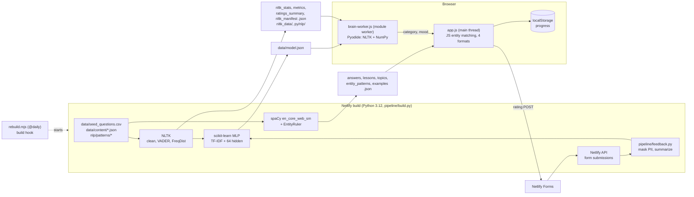

# HelpMate architecture (one page)

Author: Theo (software-architect). Date: 2026-11-23. Checked against: `netlify.toml`, `pipeline/build.py`,
`pipeline/feedback.py`, `nlp/classifier.py`, `site/js/brain.js`, `site/js/brain-worker.js`, `site/js/app.js`,
`site/js/rating.js`, `site/js/progress.js`, `netlify/functions/rebuild.mjs`. Decisions are in [docs/adr/](adr/README.md).

## In one sentence
Python does all the heavy NLP **once, when Netlify builds the site**, and saves the results as static files;
the user's browser only reads those files and runs a small amount of Python (NLTK + NumPy) in Pyodide.

## Components

| Part | Where it runs | What it does | Code |
|---|---|---|---|
| Build pipeline | Netlify build (Python 3.12) | Checks content, downloads NLTK data, pulls ratings, trains the MLP, runs spaCy, writes `site/data/*.json`, copies NLTK files and Python modules for the browser | `pipeline/build.py` (7 steps) |
| NLP modules | Build, and 2 of them also in the browser | `nltk_features.py` (clean, VADER frustration, stats), `classifier.py` (train, export, `predict_numpy`), `spacy_features.py` (entities, problems, tags; build only) | `nlp/` |
| Ratings reader | Build | Reads Netlify Forms submissions through the Netlify API, masks e-mails and phone numbers, summarizes, gives retraining rows | `pipeline/feedback.py` |
| Static site | Netlify CDN (publish folder `site/`) | HTML, CSS, JS, `data/`, `nltk_data/`, `py/nlp/` | `site/` |
| App shell | Browser main thread | Loads JSON, matches spaCy-exported entity patterns in JS, shows the four formats, panel, badges and rating form | `site/js/app.js` and friends |
| Brain | Browser Web Worker (module) | Pyodide v314.0.8 from jsDelivr, `nltk` + `numpy`, runs `predict_numpy` and `frustration` | `site/js/brain.js`, `site/js/brain-worker.js` |
| Ratings | Netlify Forms | Static form `name="rating"`, `data-netlify="true"`, honeypot; AJAX URL-encoded POST to `/` | `site/index.html`, `site/js/rating.js` |
| Progress | Browser localStorage | Key `helpmate.progress.v1`, every read and write in try/catch | `site/js/progress.js` |
| Rebuild trigger | Netlify scheduled function (JS) | Daily POST to the build hook in `BUILD_HOOK_URL` | `netlify/functions/rebuild.mjs` |

## Data flow

1. **Build** (`netlify.toml` command: `pip install -r requirements.txt && python -m spacy download en_core_web_sm && python pipeline/build.py`, publish `site`).
2. **Static JSON**: ten files in `site/data/`, each with the envelope `generated_at`, `library`, `schema_version` (contract: `reports/plan.md` section 3).
3. **Browser**: `app.js` fetches the JSON with `cache: "no-cache"`; a missing file becomes `null`, not a crash. The worker fetches `model.json`, `nltk_manifest.json`, the NLTK files and `py/nlp/*.py` into Pyodide's file system. If the worker fails, `app.js` falls back to the spaCy `category_hint` from the entity patterns (badged spaCy).
4. **Loop**: ratings go to Netlify Forms; the next build reads them, re-ranks formats and retrains. Improvement happens per rebuild, not live.

## Boundaries (what must stay true)
- Python, NLTK data downloads, spaCy and scikit-learn run **only** in the build command.
- spaCy reaches the browser only as JSON (`entity_patterns.json`, tags, `examples.json`). `nlp/spacy_features.py` is not in `PY_FILES` and is never copied to `site/py/`.
- The browser runs Pyodide (`nltk`, `numpy` only) and JavaScript. `nlp/classifier.py` imports scikit-learn only inside training functions, so it imports in Pyodide.
- No server, no database: ratings in Netlify Forms, progress in localStorage. The only function is the scheduled rebuild trigger, which serves no user traffic.
- Secrets (`NETLIFY_API_TOKEN`, `BUILD_HOOK_URL`) live in Netlify environment variables, never in `site/` or `netlify.toml`. `ratings_summary.json` holds aggregates only.
- Third-party code is pinned: Pyodide `v314.0.8` in the worker URL, `nltk==3.9.4` in `requirements.txt` to match it.

## Why this stack is simple and free on Netlify
- **One host, no servers to run.** Netlify serves static files from its CDN; Python is only needed while building, which Netlify supports with `PYTHON_VERSION`.
- **Nothing runs per request on our side.** No function cold starts, no database, no API keys in the page. The live box costs the visitor's CPU, not ours.
- **Built-in pieces instead of services.** Netlify Forms replaces a ratings database; localStorage replaces user accounts; a build hook replaces a job queue.
- **Small, boring tools.** Python stdlib + NLTK + spaCy + scikit-learn at build; plain ES modules in the browser; no bundler, no framework.
- **Fits the free tier** if rebuilds stay modest (one scheduled build a day plus pushes) and form submissions stay within the Forms allowance (check the Netlify usage page; limits change).
